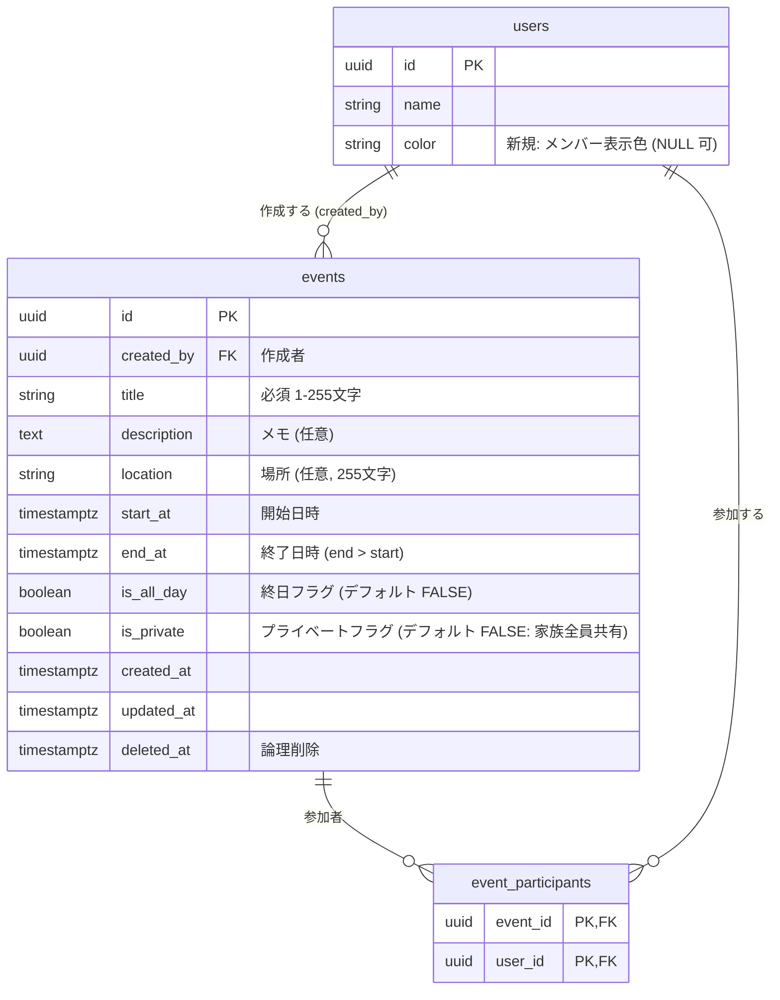

# 家族カレンダー・スケジュール機能 要件定義・設計書（Phase 2）

> [!NOTE]
> 本書は [家族専用ポータル開発ロードマップ](./family_portal_roadmap.md) の Phase 2 に対応する設計書です。
> 「8. 確認事項（決定待ち）」の内容が確定次第、本書を更新して実装に着手します。

---

## 1. 背景と前提

### 1.1 現状の把握と全体方針

本ポータルは**家族専用のプライベートポータル**であり、`users` には家族メンバーのみが登録されます。
そのため、カレンダーに限らずタスクや車両管理を含め、**「すべてのデータは基本的に家族内（全ユーザー）に公開・共有される」** ことを共通の設計原則とします。
その上で、個人の私的な情報・予定を保護できるよう、各リソースに**「プライベート用（自分のみ表示）」フラグ**を設ける方針とします。

| 項目 | 現状 | 本機能での方針 |
| :--- | :--- | :--- |
| データの共有範囲 | 従来は `user_id` による完全個別フィルタ | **原則「家族全員に共有（公開）」**。<br>プライベート（自分のみ表示）を選択可能にする |
| 家族メンバー一覧 | `GET /api/users` は管理者専用 | 一般ユーザーも利用できる軽量なメンバー一覧 API（`/api/members`）を新設 |
| カレンダー UI | 存在しない（`ui/calendar.tsx` は DayPicker のみ） | 月表示・リスト表示を新規構築 |
| 日付ライブラリ | `date-fns` v4 / `react-day-picker` v10 導入済み | 追加外部ライブラリなしでカスタム実装 |
| タスク連携 | `tasks` に `due_date` あり | カレンダー上にタスクの期日を重ねて表示可能 |

### 1.2 目的

- 家族全員の予定（学校行事・仕事・通院・家族イベント・ゴミの日など）を**一つのカレンダーで共有・把握**できるようにする。
- 自分だけの予定（私用・サプライズなど）は**「プライベート予定（自分のみ表示）」**として登録・管理できるようにする。
- 「誰の予定か」がメンバー色でひと目でわかるようにする。
- 既存のタスク期日と予定を一画面で確認できるようにする。
- Phase 3（Gemini による予定自動登録）、Phase 4（ダッシュボードウィジェット）の土台となるデータモデルを整備する。

---

## 2. 要件定義

### 2.1 機能要件

| ID | 区分 | 要件 | 優先度 |
| :--- | :--- | :--- | :--- |
| F-01 | 予定 | 予定の作成・閲覧・編集・削除（論理削除）ができる | MVP |
| F-02 | 予定 | 終日予定・時間指定予定を登録できる | MVP |
| F-03 | 予定 | 複数日にまたがる予定（旅行など）を登録できる | MVP |
| F-04 | 予定 | 参加者（家族メンバー）を複数指定できる。未指定は「家族全員」扱い | MVP |
| F-05 | 予定 | 場所・メモを登録できる | MVP |
| F-06 | 予定 | **プライベート設定（自分のみ表示）** ができる（作成者本人のみに表示、他者には完全非表示） | MVP |
| F-07 | 表示 | 月表示で予定を一覧できる（1 日に収まらない分は「+N 件」表示） | MVP |
| F-08 | 表示 | 予定リスト（アジェンダ）表示で、直近の予定を日付ごとに確認できる | MVP |
| F-09 | 表示 | メンバーごとに色分け表示される（プライベート予定には鍵アイコン 🔒 を付与） | MVP |
| F-10 | 表示 | メンバーで絞り込み表示できる | MVP |
| F-11 | 連携 | 自分のタスクの期日をカレンダーに重ねて表示できる（表示 ON/OFF 可） | MVP |
| F-12 | 操作 | 日付セルのクリックで、その日を初期値とした予定作成ダイアログが開く | MVP |
| F-13 | 連携 | ゴミ箱で削除済み予定の復元・完全削除ができる | MVP |
| F-14 | 表示 | 週表示・日表示（時間軸グリッド） | 後続 |
| F-15 | 予定 | 繰り返し予定（毎週・毎月など。ゴミの日など） | 後続 |
| F-16 | 操作 | ドラッグ＆ドロップによる予定の日時変更 | 後続 |
| F-17 | 連携 | ダッシュボードへの「今日・今週の予定」ウィジェット | Phase 4 |
| F-18 | 連携 | 自然言語・プリント画像からの予定登録 | Phase 3 |

### 2.2 非機能要件

| 項目 | 要件 |
| :--- | :--- |
| レスポンシブ | スマホ（幅 375px）で月表示・リスト表示が実用的に使えること。スマホではリスト表示を既定とする |
| タイムゾーン | 日時は `TIMESTAMP WITH TIME ZONE` で保存し、表示は JST（`Asia/Tokyo`）で統一 |
| 性能 | 表示範囲（月表示なら前後の週を含む最大 6 週間）分のみ取得する |
| 一貫性 | 既存のレイヤ構成（Router → Service → Repository）、論理削除ポリシー、`/api` プレフィックス、`SuccessResponse` 形式に従う |
| UI 規約 | `components/ui/`（shadcn/ui）は改変せず、呼び出し側で調整する |

---

## 3. データモデル設計

#### 3.1 ER 図



### 3.2 設計上の判断

| 論点 | 方針 | 理由 |
| :--- | :--- | :--- |
| 日時の持ち方 | `start_at` / `end_at`（timestamptz）＋ `is_all_day` | 時間指定・終日・複数日を 1 つの形で扱える。Google カレンダー等と同じ構造で、将来の外部連携にも対応しやすい |
| 終日予定の終了日時 | **終了日の翌日 0:00（JST）を排他的境界**として保存 | 範囲検索を `start_at < 範囲終了 AND end_at > 範囲開始` に統一できる。UI 上は「10/13〜10/14」のように包含表記に変換 |
| 参加者 | 中間テーブル `event_participants`。**0 件 = 家族全員** | 「家族全員の予定」を毎回全員選択しなくて済む。新メンバー追加時にも自動で対象になる |
| プライベート予定 | `events.is_private`（Boolean）。`true` の場合は作成者本人にしか見えない | 家族ポータルとして基本的に全公開としつつ、自分だけの予定（通院、私用など）を確実に保護できる |
| 色 | `users.color` を新設し、予定は**参加者の色**で表示。参加者 2 名以上・家族全員は共通色 | 予定ごとに色を選ばせるより「誰の予定か」が一貫して伝わる。未設定時は ID から既定パレットで自動割当 |
| 繰り返し | MVP では持たない（後続で `recurrence_rule` 列を追加予定） | 繰り返しの展開・例外日の扱いは複雑なため、基本機能を先に固める |

### 3.3 マイグレーション

- `011_create_events_tables.sql`: `events`（`is_private` 含む）・`event_participants` の作成、インデックス（`start_at`, `end_at`, `created_by`, `deleted_at`, `is_private`）、CHECK 制約（`end_at > start_at`）
- `012_add_color_to_users.sql`: `users.color VARCHAR(7)`（`#RRGGBB`、NULL 可）
- 各 `rollback` / `verify` SQL も既存の慣例に合わせて作成

---

## 4. 権限モデル

家族間の信頼を前提とし、共有予定は誰でも修正できる柔軟性を持たせつつ、プライベート予定は厳格に本人限定とします。

| 操作 | 家族共有予定（`is_private = false`） | プライベート予定（`is_private = true`） |
| :--- | :--- | :--- |
| **閲覧** | **家族全員**が閲覧可能 | **作成者本人のみ**閲覧可能（他者にはカレンダー上も完全非表示） |
| **作成** | 家族全員が作成可能 | 家族全員が自分のプライベート予定を作成可能 |
| **編集・更新** | **家族全員**が可能（「パパの代わりにママが修正」を許容） | **作成者本人のみ**可能（他者は 404 または 403） |
| **削除** | **家族全員**が可能（論理削除） | **作成者本人のみ**可能 |
| **ゴミ箱** | 削除者のゴミ箱、または作成者のゴミ箱で確認・復元可能 | **作成者本人のゴミ箱のみ**に表示 |
| **タスク重ね表示** | タスクも将来的に共有化＋プライベート対応を予定。カレンダー上は現行「自分のタスク」を表示 | - |

> [!TIP]
> 取得クエリの基本条件:
> `WHERE deleted_at IS NULL AND (is_private = FALSE OR created_by = :current_user_id)`
> この条件により、他人のプライベート予定は SQL レベルで除外され、安全に家族共有カレンダーが実現されます。

---

## 5. API 設計

すべて `/api` 配下。レスポンスは既存の `SuccessResponse[T]` 形式。

### 5.1 エンドポイント一覧

| メソッド | パス | 概要 |
| :--- | :--- | :--- |
| GET | `/api/members` | 家族メンバー一覧（`id`, `name`, `avatar_url`, `color`）。**一般ユーザーも利用可** |
| PUT | `/api/members/me/color` | 自分の表示色を変更 |
| GET | `/api/events?start=...&end=...&member_ids=...` | 期間内の予定一覧（期間は必須、最大 93 日） |
| POST | `/api/events` | 予定作成 |
| GET | `/api/events/{event_id}` | 予定詳細 |
| PUT | `/api/events/{event_id}` | 予定更新（部分更新） |
| DELETE | `/api/events/{event_id}` | 予定の論理削除 |
| GET | `/api/tasks?due_from=...&due_to=...` | **既存 API に期日範囲フィルタを追加** |

ゴミ箱 API（`/api/trash/...`）のリソース種別に `events` を追加します。

### 5.2 スキーマ（概要）

```jsonc
// POST /api/events リクエスト
{
  "title": "運動会",
  "description": "お弁当とレジャーシート",
  "location": "〇〇小学校",
  "start_at": "2026-10-18T00:00:00+09:00",
  "end_at": "2026-10-19T00:00:00+09:00",   // 終日予定は翌日 0:00（排他的）
  "is_all_day": true,
  "is_private": false,                     // デフォルト false（家族共有）。true の場合は自分のみ
  "participant_ids": ["<子どもの user_id>", "<ママの user_id>"]  // 空配列 = 家族全員
}

// EventResponse
{
  "id": "...",
  "created_by": "...",
  "title": "運動会",
  "description": "...",
  "location": "...",
  "start_at": "2026-10-18T00:00:00+09:00",
  "end_at": "2026-10-19T00:00:00+09:00",
  "is_all_day": true,
  "is_private": false,
  "participants": [{ "id": "...", "name": "...", "color": "#f59e0b" }],
  "created_at": "...", "updated_at": "...", "deleted_at": null
}
```

### 5.3 バリデーション

- `title`: 必須、前後空白除去後 1〜255 文字
- `end_at > start_at`
- `is_all_day = true` の場合、`start_at` / `end_at` が JST 0:00 であること
- `is_private`: 真偽値（デフォルト `false`）
- `participant_ids`: 存在する有効なユーザーのみ（不正時 404）
- 一覧取得の期間は最大 93 日（約 3 か月）

---

## 6. 画面設計

### 6.1 ルーティング

| パス | 内容 |
| :--- | :--- |
| `/calendar?view=month&date=2026-10-13&members=...&tasks=1` | カレンダー画面。表示状態は URL の検索パラメータで管理（TanStack Router の `validateSearch`）し、リロード・共有しても同じ表示を再現 |

サイドバーとダッシュボードに「カレンダー」メニューを追加します。

### 6.2 画面レイアウト

```text
┌──────────────────────────────────────────────────────────┐
│ ‹  2026年10月  ›  [今日]          [月 | リスト]  [+ 予定] │  ← CalendarToolbar
│ ●パパ ●ママ ●太郎 ●家族全員    ☑ タスクを表示             │  ← MemberFilter
├──────────────────────────────────────────────────────────┤
│  日   月   火   水   木   金   土                          │
│ ┌───┬───┬───┬───┬───┬───┬───┐                            │
│ │ 28│ 29│ 30│  1│  2│  3│  4│                            │
│ │   │■会議│   │   │□提出│   │■運動会━━━━│  ← 複数日はバー表示│
│ │   │🔒私用│   │   │   │   │+2件│        ← 🔒 プライベート予定│
│ └───┴───┴───┴───┴───┴───┴───┘                            │  ← MonthView
└──────────────────────────────────────────────────────────┘
  ■ = 予定（参加者の色）   □ = タスク期日（点線枠）   🔒 = プライベート予定
```

- **月表示（MonthView）**: 6 週 × 7 日のグリッド。1 セルに最大 3 件、超過分は「+N 件」で当日の一覧を開く。複数日の予定は週をまたいでバー表示。
- **リスト表示（AgendaView）**: 今日以降の予定を日付ごとにグループ化して表示。スマホでの既定表示。
- **予定の詳細**: 予定クリックで詳細（日時・場所・参加者・メモ・プライベート設定）をポップオーバー（PC）／シート（スマホ）表示し、編集・削除へ遷移。
- **予定の作成・編集（EventDialog）**: タイトル、終日トグル、開始・終了日時、プライベート（自分のみ表示）トグル、参加者（チップ選択、未選択＝家族全員）、場所、メモ。

### 6.3 コンポーネント構成

```text
frontend/src/
├── routes/_authenticated/calendar.tsx        # 検索パラメータ管理・画面組み立て
├── components/calendar/
│   ├── CalendarToolbar.tsx                    # 月移動・今日・表示切替・新規作成
│   ├── MemberFilter.tsx                       # メンバー絞り込み・タスク表示トグル
│   ├── MonthView.tsx                          # 月グリッド
│   ├── AgendaView.tsx                         # リスト表示
│   ├── EventChip.tsx                          # 予定／タスクの表示片（🔒 バッジ対応）
│   ├── EventDetail.tsx                        # 詳細ポップオーバー／シート
│   ├── EventDialog.tsx / EventForm.tsx        # 作成・編集フォーム（プライベートトグル付き）
│   └── EventDeleteDialog.tsx
├── hooks/queries/useEvents.ts / useMembers.ts # TanStack Query
├── lib/api/events.ts / members.ts
├── lib/types/event.ts / member.ts
├── lib/validations/event.ts                   # zod スキーマ
└── lib/calendar.ts                            # 月グリッド生成・予定の日別割付・終日変換などの純粋関数
```

### 6.4 カレンダー UI の実装方式

| 方式 | 長所 | 短所 |
| :--- | :--- | :--- |
| **A. カスタム実装（推奨）** | `date-fns` で実装でき追加依存なし。Tailwind / shadcn と見た目を統一しやすい。月表示＋リスト表示なら実装量も妥当 | 週・日の時間軸グリッドを作る際に工数がかかる |
| B. FullCalendar | 月・週・日表示、ドラッグ操作が揃っている | 独自 CSS のため Tailwind v4 との見た目の統一に手間。バンドルが約 200KB 増える |

MVP は月表示＋リスト表示のため **A（カスタム実装）** で進めます。週・日表示が必要になった時点で B への切り替えも再検討します。

---

## 7. 実装ステップ

| Step | 内容 | 完了条件 |
| :--- | :--- | :--- |
| **1. バックエンド基盤** | マイグレーション（011/012）、`Event`・`EventParticipant` モデル、Repository / Service / Router、`/api/members`、タスクの期日範囲フィルタ、ゴミ箱対応 | pytest（単体・統合）追加・全件パス、マイグレーションをローカル DB に適用 |
| **2. フロント基盤＋月表示** | 型・API・Query フック、`/calendar` ルート、ツールバー、月表示、予定の作成・編集・削除ダイアログ（プライベート対応） | 月表示で予定の CRUD が一通りできる |
| **3. リスト表示・絞り込み・タスク連携** | リスト表示、メンバー絞り込み、色分け、タスク期日の重ね表示、スマホ対応、自分の色設定 | スマホ幅で実用的に操作できる |
| **4. 仕上げ** | サイドバー・ダッシュボード導線、ゴミ箱画面に「予定」タブ、ドキュメント更新 | `make lint` / `make test` パス |

後続（別途計画）: 週・日表示、繰り返し予定、ドラッグ＆ドロップ、ダッシュボードの「今日の予定」ウィジェット（Phase 4）。

---

## 8. 決定事項（合意内容）

| # | 論点 | 決定内容 |
| :--- | :--- | :--- |
| 1 | 基本のデータ共有範囲 | **原則「家族全員に共有（公開）」**。予定・タスク・車両も家族全員が見える前提 |
| 2 | プライベート（自分のみ）機能 | **`is_private` フラグを導入**。ON の場合は作成者本人にしか見えない・編集できない |
| 3 | 共有予定の編集・削除権限 | 家族間の信頼を前提とし、**共有予定は家族全員が編集・削除可能** |
| 4 | 繰り返し予定（ゴミの日など） | MVP では含めず、Step 4 の後に追加 |
| 5 | 表示形式 | **月表示＋リスト表示**（週・日表示は後続） |
| 6 | カレンダー UI の実装方式 | **カスタム実装（A）**（`date-fns` 活用、追加依存なし） |
| 7 | メンバーの色 | `users.color` を新設し、各自が設定可能（未設定時は ID から自動割当） |
