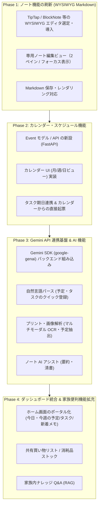

# 家族専用ポータル開発ロードマップ計画

本ドキュメントは、家族専用ポータルサイト `ynym-portal` における機能拡充計画、アーキテクチャ方針、および段階的な実装ロードマップを定義した計画書です。

---

## 1. ビジョンと開発方針

### 1.1 ビジョン
**「家族の生活情報・ツール・知恵が一箇所に集約され、AI が日常をサポートするデジタルリビング」**

日々の生活に必要な情報（メモ、生活マニュアル、予定、車・買い出しの管理など）を家族全員がストレスなく参照・更新でき、さらに Gemini AI を活用してプリントの読み取りや予定登録、ドキュメントの整理といった日常のちょっとした負荷を軽減するポータルを目指します。

### 1.2 主要な柱
1. **高機能ノート（Knowledge & Docs）**: Notion や Obsidian のような WYSIWYG Markdown による快適な執筆環境とドキュメント保管
2. **家族カレンダー・スケジュール（Schedule & Calendar）**: 家族のイベント・予定を可視化し、タスク機能と連携
3. **Gemini API 連携（Family AI Assistant）**: お便り画像の解析、自然言語による予定・タスク登録、ノート執筆支援
4. **生活便利ツール & ダッシュボード（Living Hub）**: 今日の情報がひと目でわかるダッシュボード、買い物リストなど

---

## 2. 現在のベースラインと機能一覧

すでに本システムには堅牢なモノレポ基盤と基本機能が実装されています。

| 機能 / 領域 | 実装状況 | 概要 |
| :--- | :--- | :--- |
| **認証基盤** | 実装完了 | Google OAuth + HttpOnly Cookie / BFF セッション管理 |
| **タスク管理** | 実装完了 | タイトル、説明、ステータス、期日、優先度、担当者 |
| **ノート機能 (基礎)** | 実装完了 | タイトル、本文（プレーンテキスト）、カテゴリ分類 |
| **車両・燃費管理** | 実装完了 | 車両情報管理、給油量・走行距離・燃費の自動計算・グラフ化 |
| **管理機能・ゴミ箱** | 実装完了 | ユーザー管理、論理削除データのゴミ箱（復元・完全削除） |

---

## 3. おすすめ機能体系の詳細

### ① 高機能ノート（Notion / Obsidian 風 WYSIWYG Markdown）
- **WYSIWYG Markdown エディタ**:
  - 見出し（H1〜H3）、チェックボックス（ToDo）、箇条書き、番号付きリスト、テーブル（表組み）、引用、コールアウト
  - Notion風のスラッシュコマンド（`/` 入力によるメニュー展開）
  - Markdown 記法ショートカット（`# ` で見出し、`- ` でリスト、`[]` でチェックボックスなど）
  - 画像のドラッグ＆ドロップ / クリップボード貼り付け
- **UI / UX 刷新**:
  - モーダル内入力から、独立したノート詳細・執筆ビュー（全画面/フォーカスモード）への刷新
  - 左ペイン（カテゴリやノート一覧）と右ペイン（エディタ/プレビュー）の分割レイアウト
- **家族ナレッジ・生活マニュアル**:
  - 家電の取扱説明書リンク・型番、ゴミ出しルール
  - 病院・かかりつけ医・処方薬メモ、保険証・契約情報
  - 非常時連絡先、防災リュック備蓄リスト

### ② 家族スケジュール・カレンダー管理
- **カレンダービュー**:
  - 月表示 / 週表示 / 日表示の切り替え
  - 家族メンバーごとのカラー色分け（例: パパ、ママ、子ども、家族共通）
  - 終日予定・時間指定予定、リピート予定（毎週、毎月等）
- **タスク機能とのシームレス統合**:
  - 既存のタスク（期日あり）をカレンダー上に同時表示
  - カレンダー上の日付クリックから直接「タスク」または「イベント」を作成
- **ダッシュボード連携**:
  - ホーム画面に「今日の予定」「今週の家族の予定」ウィジェットを表示

### ③ Gemini API 連携（家族向け AI アシスタント）
- **プリント・お便り解析（マルチモーダル OCR）**:
  - 学校や自治体のプリント写真をアップロードすると、Gemini が「行事名」「日時」「持ち物」「提出期限」を自動抽出し、ワンクリックでカレンダー登録やタスク作成
- **ノート執筆・整理アシスト**:
  - メモの要約、誤字脱字チェック、箇条書きの清書
  - 走り書きのメモから綺麗な生活ドキュメント・手順書を生成
- **自然言語によるクイック登録**:
  - 「来週土曜18時に外食」「明日牛乳を買う」と入力するだけで、日時や内容を解析して予定やタスクを自動起票
- **家族内 Q&A（生活ナレッジ検索）**:
  - ポータル内に保存されたノートをもとに「〇〇小児科の休診日いつだっけ？」「車の任意保険の連絡先どこ？」に即答

### ④ 生活便利機能 & ダッシュボード拡張
- **リアルタイム共有買い物リスト**:
  - 買ったらチェックして非表示、家族が外出先からスマホでサッと確認・追加
- **生活ダッシュボード**:
  - 「今日の予定」「今日のタスク」「直近の家族ノート」「車両の次回点検日」などが一望できるホーム画面

---

## 4. 段階的実装ロードマップ

---

## 5. 各フェーズの実装計画

### Phase 1: ノート機能の刷新（WYSIWYG Markdown）
- **目的**: プレーンテキスト入力から、Notion/Obsidianのように快適に書けるドキュメント執筆環境へ刷新する。
- **タスク**:
  1. **エディタ選定と検証**:
     - React 19 / Tailwind CSS v4 / shadcn/ui と親和性の高い `TipTap` (`@tiptap/react` + `@tiptap/starter-kit` + `tiptap-markdown`) などを導入・検証。
  2. **UI レイアウト刷新**:
     - モーダル編集（`NoteDialog`）から、Notionライクなフルページ執筆画面（`/notes/$noteId`）または2ペイン画面へルーティングを拡張。
  3. **Markdown 互換性**:
     - バックエンドの `body: Text` はそのまま Markdown 文字列として保存し、既存データとの後方互換性を維持。
  4. **リッチ機能の段階的追加**:
     - スラッシュコマンド、チェックボックス（ToDo）、見出し、コードブロック、テーブル。

### Phase 2: 家族カレンダー・スケジュール機能
- **目的**: 家族のイベントや予定を全員で共有・把握できるカレンダーを新設する。
- **タスク**:
  1. **バックエンド**:
     - `Event` モデル設計（ID, タイトル, 説明, 開始日時, 終了日時, 終日フラグ, 参加者/対象メンバー, 場所, 色タグ）。
     - CRUD API、ソフトデリート対応、リポジトリ・サービス層の実装。
  2. **フロントエンド**:
     - ルート `/calendar` を追加。
     - カレンダーUIコンポーネント（FullCalendar やカスタム月/週ビュー）の実装。
     - 予定の作成・編集ダイアログ。
  3. **タスク連携**:
     - タスク（`tasks`）の締め切り日をカレンダー上にアイコン付きで重ねて表示。

### Phase 3: Gemini API 連携（AI アシスタント）
- **目的**: Gemini API を活用し、家族の入力・情報整理の負担を軽減する。
- **タスク**:
  1. **バックエンド API 基盤**:
     - `uv add google-genai`（公式 SDK）の導入。
     - API キー設定（`GEMINI_API_KEY`）とクライアントサービス層（`app/services/ai_service.py`）の構築。
  2. **自然言語パーサー**:
     - 「明日の19時に家族で外食」等のテキストから JSON（タイトル、日時、種別）を構造化抽出するエンドポイント。
  3. **プリント・画像解析**:
     - 画像アップロードから行事名、持ち物、期限を抽出し、予定/タスクの下書きを生成。
  4. **ノート AI アシスタント**:
     - ノート画面での「要約する」「誤字を直す」「箇条書きに整形」ボタン。

### Phase 4: 生活ダッシュボード統合 & 便利機能拡充
- **目的**: 毎朝・毎日開きたくなる家族の「デジタルホーム」を完成させる。
- **タスク**:
  1. **ダッシュボード全面刷新**:
     - 「今日の予定」「期限間近のタスク」「ピン留めされた家族ノート」「車の給油情報」を一覧できるウィジェット型ダッシュボード。
  2. **共有買い物リスト**:
     - チェックで即座に完了するシンプルで高速な買い物リスト。
  3. **生活ナレッジ Q&A**:
     - 保存されたノートを検索・参照して質問に答える家族内 Q&A。

---

## 6. 技術選定の候補と推奨

| 領域 | 推奨ライブラリ / ツール | 選定理由 |
| :--- | :--- | :--- |
| **WYSIWYG Markdown** | **TipTap** (`@tiptap/react`) | ProseMirror ベースで拡張性が高く、shadcn/ui との統合が容易。Markdown エクステンション (`tiptap-markdown`) で Markdown の入出力に対応。React 19 にも適合。 |
| **カレンダー表示** | **FullCalendar** または **React-Big-Calendar** | 実績豊富で月/週/日ビュー、終日イベント、ドラッグ＆ドロップ操作のサポートが充実。 |
| **AI (LLM / Multimodal)** | **Gemini 2.5 Flash / Pro** (`google-genai`) | 高速かつ安価（または無料枠が広い）。マルチモーダル（学校プリントの写真読み取り）の精度が極めて高い。 |
| **状態管理 / API 通信** | **TanStack Query v5** (既存) | 既存のキャッシュ管理・オプティミスティック更新パターンを踏襲。 |

---

## 7. 更新履歴

- **2026-09-29**: 初版作成（家族専用ポータルの機能体系整理および Phase 1 〜 4 ロードマップ策定）
